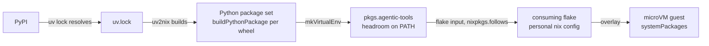

## Purpose

Nix packaging for `headroom-ai` (an LLM context-compression proxy), a PyPI tool with no nixpkgs
equivalent, built via
[uv2nix](https://github.com/pyproject-nix/uv2nix) from a pinned `pyproject.toml` + `uv.lock`.
Consumed by a personal microVM fleet that previously installed it at guest-boot time via
`uvx --from <pkg> ...`, paying a cold network fetch (and, after that was cached offline, real
packaging risk — platform-tag mismatches, non-reproducible local caches) on every fresh sandbox.
This flake replaces that runtime fetch with ordinary build-once, substitute-everywhere Nix
packages.

No deep spec: this is a thin packaging wrapper (pin one version, let uv2nix build the resolved
wheel set) with no runtime pipeline, protocol, or stateful subsystem of its own to specify — the
ADRs below cover the decisions that matter.

## Layout

| Path | Purpose |
|------|---------|
| `flake.nix` | Loads the uv workspace, builds the python package set via uv2nix + pyproject-build-systems, exposes `packages.{aarch64-linux,x86_64-linux}.{default,agentic-tools}` |
| `pyproject.toml` | The only "dependency" this project has: the pinned headroom-ai version |
| `uv.lock` | Full resolved dependency tree (101 packages), regenerated with `uv lock` |
| `.github/workflows/ci.yml` | `nix flake check` + `nix build` + `nix fmt --check` |
| `renovate.json` | Auto-bumps `flake.lock`; flags `pyproject.toml` version-pin updates (manual `uv lock` re-run required after accepting one) |

## Stack

Nix flake, [uv2nix](https://github.com/pyproject-nix/uv2nix) + [pyproject.nix](https://github.com/pyproject-nix/pyproject.nix)
+ [build-system-pkgs](https://github.com/pyproject-nix/build-system-pkgs) for the Python package
set, `nixpkgs-unstable` as the base (Python ML packaging — onnxruntime — tends to need
newer nixpkgs than a stable branch carries).

## Build / run

```sh
nix build .#packages.x86_64-linux.default   # or aarch64-linux -- see docs/decisions/linux-only-no-macos.md
nix flake check --all-systems
```

The output is one environment (`agentic-tools`) with `headroom` on `PATH`.

## Context



## Decisions

See [`decisions/`](decisions/README.md) for the ADRs: why uv2nix over a hand-rolled fetch
derivation, why Linux only, why code-context-engine was dropped.
